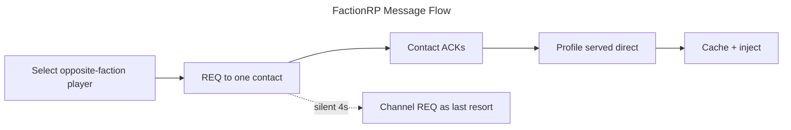

# FactionRP

_FactionRP_ is a continuation of the original CrossRP AddOn for World of Warcraft.

It attempts to pull data across faction boundaries by leveraging people's Battle.NET
connections and cross-faction community/guild whispers.
The more people are connected and using this AddOn, the more data can be shared.

Data is exchanged on demand — a `REQ`/`ACK`/`OK` handshake pulls a profile once,
server to requester — rather than broadcast. When nothing is being requested the
AddOn is silent: no profile data ever floods the wire.

Unlike CrossRP, the AddOn does not designate people as "servers", but tries to utilize the ingame
communication possibilities to spread information.

## Communication Structure



### Select Player

When a player is "selected" (mouseover or target), two things can happen:

* **Same-faction / ourselves**: the profile is extracted and *published to the
  local cache* — no wire traffic. Serving reads the RP AddOn's register live
  (TRP3 owns same-faction freshness itself), so the publish mostly keeps our
  GUID→unitID map warm for requests that arrive without a unitID.
* **Opposite-faction**: this is the pull trigger. If the subject's profile is
  not fresh in our cache, we send a `REQ` for their GUID — carrying their
  unitID when we know it — into the serial pull pipeline (see "The pull
  exchange").

A player is also "selected" indirectly: whenever the RP AddOn itself receives
profile data over its own comm channels — like TRP3's exchange protocol, or MSP
for non-TRP3 AddOn — that profile is extracted and cached the same way (still
no wire traffic), with a debounce+jitter collapsing per-section receipt bursts
and a bounded queue draining at most one extraction per interval.

Feedback from our own traffic is deliberately ignored: profiles we push into the
RP AddOn's register (directory injection and tooltip enrichment) fire the same
"profile updated" signals as real data. Re-extracting on those would churn the
cache for nothing, so the Scanner only re-publishes for units the user actually
selected this session (mouseover/target, or ourselves), and skips a publish
whose content version is unchanged since the last one (`lastSharedVersion`).

### Extract Profile

A player's profile will be extracted from the supported AddOns. (Initially TRP3)
Since every player has a unique GUID in the game, we use that GUID to store the profile.
We can also use the same GUID to look up a profile, allowing the AddOn to display the profile when data is available.

### The pull exchange

Profile data never floods. It travels exactly once — server to requester —
after a granted request, using single-chunk FRP1 control messages
(`subject = "_frp"`, `data = "FRP1 <verb> <arg>"`; see `doc/protocol.md`).
Requests are **serial**: one subject at a time, each tried against exactly
one contact picked by a round-robin cursor that walks confirmed Battle.net
peers first, then guild relays, then community relays. Every contact
serves at most one request per cycle, then the cursor wraps.

1. **REQ \<guid\> [unitID]** — unicast to the picked contact (whisper or
   Battle.net). The unitID is the subject's register key ("Name-Realm"),
   so the holder can answer straight from its RP AddOn's register.
2. **ACK \<guid\>** — the contact replies if its register holds the
   profile. The subject's identity is consensus-checked first: every claim
   held for the guid (local cache, client player-info, club roster, and
   the wire-asserted unitID) must agree — conflicting or absent claims
   stay silent. Silence is the only rejection; there is no `NOK` here.
3. **OK \<guid\>** — the requester grants the offer. The server refreshes
   its held copy through the RP AddOn's own headless query when stale,
   then sends the normal data envelope directly to the requester, who
   waits up to `REQ_DATA_TIMEOUT` (120s) for it; other subjects queue
   meanwhile. Ungranted offers just expire — denied or obsolete offers
   never cost a data leg.
4. **Channel fallback** — no reply within `REQ_CONTACT_TIMEOUT` (4s), or
   no contacts at all: a *stranger* subject gets one channel attempt,
   skipped when it shares a club or group with us or is a BNet friend —
   those relations already provide a pull path. The mesh `REQ` collects
   whispered `ACK` offers for `REQ_CHANNEL_WINDOW` (3s), then `OK`s the
   best freshness claim; every other offer just expires.

A pull is also skipped entirely for subjects sharing one of our clubs
(community or guild): TRP3 already sends its own vernum query on
mouseover/target, and the shared membership is exactly what makes that
cross-faction whisper deliverable — a `REQ` would just duplicate the native
pull (which fills our cache anyway once it lands, via the received listener).

Requests deduplicate per subject (active + queued + a 60s cooldown) and
wait in a small bounded FIFO. On the serving side, unicast REQs are
throttled per sender (`REQ_SENDER_INTERVAL`), while channel REQs are
gated by a per-requester throttle and a drain-aware serve cooldown: we
answer no broadcasts while a serve's chunks are queued, and stay muted
for 10–60s after a mesh serve's last chunk leaves — scaled by the channel
member count so a thin mesh keeps serving while a dense one shares the
load. On a dense mesh (more than `REQ_MESH_SAMPLE_AT` members) the
fallback also whispers its REQ to `REQ_MESH_SAMPLE_SIZE` random channel
members instead of broadcasting, so every holder does not answer at
once — the flagged REQ keeps the ACK/OK arbitration and only the best
offer serves. Requesters' timeouts pace their retries; no "busy" wire
traffic is spent. Requests for our *own* profile bypass the cooldown.

### Message Structure

Because we're dealing with Lua and limitations imposed by the World of Warcraft client,
we keep our messages scoped to the minimum data. 
We use `||` as separator, as this does not conflict with most AddOns.

**structure**:
```
SENDER-PLAYER-GUID||SUBJECT-PLAYER-GUID||SUBJECT-NAME-REALM||SOURCE-ADDON||ORIGIN-TIME||CONTENT-VERSION||PROTO-VERSION||PROFILE-DATA
```

* `SUBJECT-NAME-REALM` is required because a GUID alone cannot be resolved to a character
  name for players who are not in our vicinity. The supported RP AddOns (e.g. TRP3) key their
  data store by `Name-Realm`, so we must carry it to be able to display the profile later.
* `SOURCE-ADDON` is the AddOn the profile originated from (e.g. `TRP3`), so the receiver knows
  which adapter to use.
* `ORIGIN-TIME` is the sender's freshness *claim* for the copy it serves: `time()`
  for self-serves, the holder's own last-seen "as of" stamp otherwise — never the
  serve time, so a stale held copy cannot masquerade as freshly authored. It is the
  ordering key: a copy with a newer origin-time always supersedes an older one.
* `CONTENT-VERSION` identifies the profile content. For TRP3 it is the combination of its
  per-section version counters (`.v`). Because those counters wrap (1..99) and are not globally
  ordered, content-version is only ever compared for *equality* (to detect "same vs changed");
  `ORIGIN-TIME` provides the actual ordering. Together they de-duplicate received copies
  and prevent stale and fresh copies from flapping between peers.
* `PROTO-VERSION` is the wire-protocol generation (`C.PROTO_MAJOR`). Receivers reject
  any envelope advertising a lower generation *before* touching peer state, and the
  comm channel carries the generation in its name (`frp5comms`) — older-protocol
  clients, including modified ones, can neither interop nor confirm themselves.
  A sender whose completed message fails this gate (or fails to parse at all) is
  additionally placed on a short blocklist (`REJECTED_SENDER_TTL`), so a hostile or
  legacy peer's chunks stop reaching the reassembler entirely.

Because a single in-game AddOn message is capped at 255 bytes, larger profiles are split into
numbered chunks and re-assembled by the receiver before processing.

### Battle.net peer confirmation

We never assume a Battle.net friend runs FactionRP. The `HELLO`/`HI`
handshake confirms peers session-locally:

* Only a friend's *opposite-faction* WoW characters enter the peer pool —
  a friend playing our faction is reachable on the comm channel anyway.
* Every `BNET_PROBE_INTERVAL` (5s) we burst `HELLO`s to every eligible
  friend — unconfirmed, non-ignored, none awaiting — bounded by the shared
  send budget; the reply is `HI`.
* Any complete, parseable FactionRP message from an account — handshake or
  otherwise — confirms it for `BNET_CONFIRM_TTL` (10 min).
* A probe unanswered past `BNET_PROBE_DEADLINE` (60s) ignores the account
  for `BNET_IGNORE_TTL` (10 min); the ignored account *coming online*
  (`BN_FRIEND_ACCOUNT_ONLINE`) re-opens probing early with a fresh slate —
  mere presence churn (zone changes, status updates) does not.
* Data and `REQ` legs on Battle.net go to confirmed accounts only.

Whisper relays use the same handshake lifecycle: `HELLO` probes walk the
cross-faction club rosters on a rotating cursor, and any parseable inbound
whisper confirms the sender as a relay.

### Version announcements

Because there is otherwise no way to learn that your FactionRP is outdated
except checking Curse, every client announces its addon version once per
session: shortly after logging in it broadcasts a single version message on
our hidden comm channel (see "Request pipeline"). The announcement also goes
to the previous protocol generation's channel — old-protocol peers are on a
disjoint channel by design, so we briefly join `frp3comms`, launch the
announcement, and leave again. Since that channel is
faction-scoped, every faction-mate running FactionRP hears the announcement
the moment someone logs in with a newer build.

When such an announcement is received, the advertised version is compared
against our own (the installed build's version, read from the `.toc` via
`C_AddOns.GetAddOnMetadata`, not the `C.VERSION` constant); if it is newer,
an update notice is printed in chat. Notices are deduped by the highest
version already announced that session, so a wave of peers logging in
cannot spam the chat — and since
faction-mates log in with updated builds eventually, you get told to update
sooner or later, right when it happens.

The announcement is sent once, carries no profile data, and no reply is ever
sent: it only carries awareness, not requests. `/frp status` shows the newest
version announced by any peer this session.

### Request pipeline
There is no data broadcast: only single-chunk control messages travel, and
profile data moves once per exchange. A pull's *subject* is always
opposite-faction, but its *servers* need not be — every faction-mate who
previously pulled the same subject is a holder. A `REQ` therefore goes to:

* **One contact at a time**, picked by the round-robin cursor:
  confirmed Battle.net friends first (account-to-account; only
  opposite-faction characters qualify), then confirmed guild-club
  relays, then confirmed
  community-club relays — each reachable by addon whisper (see
  "Community relays"). There is no "community" medium — clubs can't carry
  addon messages; shared membership is what makes a `WHISPER` send
  *deliverable* cross-faction, and the roster only enumerates those
  targets. If the subject themselves is a confirmed BNet peer they are
  picked first — a self-serve is authoritative.
* **The hidden same-faction comm channel** — `frp5comms`, an ordinary
  custom chat channel (like `/1`) joined via `JoinTemporaryChannel` — as
  the last resort when the contact stays silent or none exist. Custom
  channels are faction-scoped, so one chunk reaches *every* same-faction
  FactionRP listener — the biggest pool of candidate servers. Channel
  sends echo back to the sender and are dropped on receipt.

Every leg is a single hop: the requester sends each `REQ` itself, and a
server's `ACK` and profile reply travel directly back to the requester.
"Relay" means a reachable cross-faction *endpoint* — no client forwards
messages for anyone else. A requester with **no** reachable contact gets
nothing: the faction channel is never asked, since its answers are caches
by construction.

Requests also share an in-flight budget with `HELLO` probes
(`FANOUT_INFLIGHT_MAX` sends still queued on the wire), so nothing new
stacks behind a saturated queue. Pending subjects wait in a small dedup'd
FIFO (`REQ_BACKLOG_CAP`) and are re-validated when released — a subject
whose profile arrived from another exchange while it waited never sends.

All chunk sends go through a paced internal queue — `C.SEND_RATE` chunks per
second is the single outbound rate dial, released via a token bucket on the
`SEND_INTERVAL` tick — and each primitive is additionally routed through **Chomp** —
the ChatThrottleLib wrapper TRP3 already ships — on the `LOW` priority queue,
falling back to the raw `C_ChatInfo.SendAddonMessage` / `BNSendGameData` calls
when Chomp is unavailable. This coalesces our outbound traffic into the same
global throttle queues every addon shares, so FactionRP cannot starve another
addon's sends (notably TRP3's unthrottled map-scan `C_SCAN` requests, which are
sensitive to chat-frame send backoff — see issue #1). The comm channel join is
also idempotent: it is skipped when we are already in the channel, since every
join fires channel-list churn that other addons' channel bookkeeping reacts to.

### Community relays

WoW communities cannot carry addon messages directly, but cross-faction *whispers* —
including addon whispers — work between members of a shared community. Every `REQ`
therefore also whispers a capped set of opposite-faction members of our own
subscribed clubs — run as **two independent legs**: communities (`COMM_RELAY_LIMIT`)
and our own guild (`GUILD_RELAY_LIMIT`; cross-faction guilds make those members
whisper-reachable too, and the leg is skipped entirely when guildless). Both legs
select online members only, deduplicated by GUID across clubs. These legs carry
single-chunk control messages, and every client maintains its own relay lists —
coverage is distributed across requesters.

Rather than waiting for requests, we **actively probe** the roster: every
`RELAY_PROBE_INTERVAL` (30s) a burst of up to `RELAY_PROBE_BURST` (5)
candidates gets a whispered `HELLO`, walked in order through the guild list
then the community list so everyone gets a turn. Each candidate gets exactly
one probe: a whispered `HELLO` earns a `HI` reply and any parseable inbound
whisper confirms the sender as a relay for `RELAY_CONFIRM_TTL` (10min);
a probe with no answer inside `RELAY_PROBE_COOLDOWN` (45s) kicks the target
to the ignore list. Ignore is offline-aware rather than time-driven —
someone who stays online stays ignored (their silence is the answer), while
a member observed *offline* by the roster scan is un-ignored and earns a
retry when they return. Confirmed relays are never probed — real inbound
traffic is the only thing keeping them warm. Members without
FactionRP simply cannot parse or answer.

Whisper legs now reach only proven targets — the unconfirmed roster is the
probe rotation's job, so a `REQ` never whispers strangers:

1. **Confirmed FRP peers** — a relay whose confirmation is still fresh.
2. **Known cross-faction contacts** — opposite-faction club members whose profiles
   reached us via the RP AddOn's own comms (e.g. a TRP3 profile arriving cross-faction
   through the community): proven reachable, almost certainly RP-AddOn users.
   (Ignored targets are skipped either way.)

No single member should act as a relay server, so fairness is enforced two ways:
a **round-robin cursor** spreads picks across the candidate list rather than always
starting from the front, and each contact may be used at most `COMM_USAGE_LIMIT`
times per `COMM_USAGE_WINDOW` seconds — shared across both legs, so a person who is
both guildmate and community member still has one budget. Exhausted contacts are
only re-used when too few fresh candidates remain — coverage is never dropped for
lack of fresh targets.

Club member lists, member factions (`ClubMemberInfo.faction` is `NeverSecret`), and
presence come from `C_Club`. The roster is rebuilt incrementally (`ROSTER_SLICE`
member lookups per frame) so large communities never stall a frame, and the same
memoized roster serves GUID resolution. During chat-messaging lockdown those APIs
yield secrets, so the leg silently no-ops; whisper sends also fail gracefully
(`AddOnMessageLockdown`) — see "Security restrictions" below.

A message should be ignored when any of the following is true:

* The sender GUID is the same as the user's GUID (loop avoidance).
* We already hold the subject's profile with the same `CONTENT-VERSION`, or with an `ORIGIN-TIME`
  newer than the incoming message (de-duplication / staleness rejection). We only store and
  inject when the content differs *and* the incoming copy is not older.

Control messages (`subject = "_frp"`) are handled by the exchange state machines
and never cached, injected, or relayed.

### Directory injection

Profiles stored from exchanges are also injected into the source RP AddOn's register,
so its directory/character list populates as data arrives — not only on tooltip.
Injections drain through a small bounded queue (`INJECT_BURST` per `INJECT_INTERVAL`)
because register writes fire the AddOn's own update and UI-refresh events.

### Cache Structure

The cache needs to do a little bit more than just track the GUID and Profile.
It needs to track the following data:

* The GUID of the player who's profile is stored (cache key)
* The `Name-Realm` of that player (needed to display/inject the profile)
* When the entry was added locally (drives the 5 minute TTL / expiry)
* The `ORIGIN-TIME` and `CONTENT-VERSION` of the profile (used for ordering and de-duplication)
* The AddOn of the profile, e.g. TRP3 or something
* The actual Profile data

### Tooltip update

The AddOn needs to rebuild tooltips for players of the opposite faction.
If the player of the opposite faction has an entry in our cache, load it and apply it.
For this we can probably leverage the functionality of TRP3 to achieve the same result.

In practice this means: when an opposite-faction unit is hovered/targeted and we hold a cached
profile for their GUID, we inject that data into TRP3's own register (keyed by `Name-Realm`) via
its public API (`addCharacter` → `saveCurrentProfileID` → `saveInformation`, gated by
`shouldUpdateInformation`). TRP3 then renders the tooltip itself, so we do not maintain a separate
tooltip implementation. Injected entries are treated as transient and respect the 5 minute TTL.

### Slash Commands

All commands are available under `/factionrp` or the shorter alias `/frp`.
Running the base command with no (or an unrecognised) sub-command prints the usage list.

* `/factionrp status` — Show the version, number of cached profiles, pending
  received-profile publishes, send-queue depth, known relay/contact counts, the
  active RP adapter (e.g. TRP3) and which debug categories are on.
* `/factionrp purge` — Empty the profile cache (testing).
* `/factionrp debug` — List the debug categories and their on/off state.
* `/factionrp debug <category>` — Toggle one debug category (see below).
* `/factionrp debug all [on|off]` — Toggle every category at once.
* `/factionrp relays` — Show learned relay state: confirmed FRP whisper
  relays, proven cross-faction contacts, online roster candidates per leg,
  Battle.net peers by bucket (confirmed / probing / ignored), the pending
  request/serve counts, the contact cursor position, and pinned targets.
* `/factionrp debug target [Name-Realm]` — Pin a whisper target that bypasses
  the community/guild selection and caps (testing). `clear` resets; no argument
  lists pins. Only sends while the `targets` category (or `all`) is on.
* `/factionrp stats [section]` — Show collected traffic statistics (requires
  the `stats` category). Sections: `mediums`, `sizes`, `timing`, `cache`,
  `errors`, `queue`, `last [n]`; `reset` zeroes everything.
* `/factionrp mem` — Show live addon memory after a forced garbage collection
  and counter refresh. `churn [n]` samples the allocation rate over n seconds
  (default 10); `census` counts the suspect internal tables (queues, cache,
  reassembly buffers, roster maps, memos).

### Debug Mode

Debug output is fractionalised: each category can be enabled independently so
debugging can be targeted, or everything can be enabled at once with
`/frp debug all`. Flags persist in saved variables as `FactionRPDB.debug`.

The categories:

* `receive` — a message is received, including sender GUID
* `cache` — a profile is stored or refreshed in the cache
* `queue` — a received RP-AddOn profile is queued for re-publication, or skipped
* `fanout` — the REQ contact pick (medium + target; see also
  `/frp relays`)
* `chunks` — every wire chunk sent or received (very noisy)
* `targets` — allows pinned whisper targets (`/frp debug target`) to send
* `peers` — Battle.net handshake and pull-exchange events (probes,
  confirmations, ignores, REQ/ACK/OK/NOK traffic, serves)
* `stats` — collects traffic statistics (see below)

### Traffic statistics

With the `stats` category enabled, FactionRP records session-only traffic
statistics (nothing is persisted, and everything is bounded so long sessions
cannot grow memory):

* Inbound/outbound message counts, byte sizes (average and median), and
  per-second rates over a rolling 60 second window plus the session average
* Profile reassembly time: first to last chunk of a multi-chunk message
* Transmit time: enqueue to last chunk sent, per leg
* Per-medium breakdowns (channel, group, Battle.net, whisper) and per-leg
  fanout totals
* Cache outcomes (new/updated/refreshed/rejected), error tallies (malformed,
  old-protocol, undecodable, self-echo, reassembly timeouts, duplicate chunks,
  queue drops)
* Queue health: send-queue high-water mark, per-chunk dwell, inject/received
  queue depths
* Origin age on receipt (approximate — depends on the sender's clock)
* Unique senders/subjects seen this session
* A ring buffer of the last 50 messages for close inspection
  (`/frp stats last [n]`)
* The send queue is bounded (`SEND_QUEUE_CAP` = 384 chunks): when outbound
  demand exceeds the paced drain rate, legs that cannot fit are dropped
  whole — never individual chunks, which would guarantee an incomplete
  message at the far end. Dropped legs are counted as `send_queue_drop`
  under `/frp stats errors`.

`/frp stats` prints a summary; the sections drill into each area. The same
data is available programmatically via `ns.Stats.snapshot()`.

### Memory diagnostics

`/frp mem` forces a collection, refreshes the client-side memory counter and
reports live (retained) addon memory. `/frp mem churn [n]` then samples the
uncollected counter once a second: the peak-to-baseline delta approximates
allocation churn between GC cycles — the figure to watch when judging whether
hot paths are allocating. `/frp mem census` dumps the live size of every
internal table that could plausibly grow.

### Additional Plans

These points are to be kept in consideration, but will not be part of the current release:

* Ability to load/store additional data such as TRP3 about pages

Already done since this list was written: per-message sender tracking (the
`stats last` ring records medium + peer) and on-demand profile fetching (the
pull exchange does exactly this).

### AddOn documentation

* [World of Warcraft API](https://warcraft.wiki.gg/wiki/World_of_Warcraft_API)
* [Lua Functions](https://warcraft.wiki.gg/wiki/Lua_functions)
* [Widget API](https://warcraft.wiki.gg/wiki/Widget_API)
* [Events](https://warcraft.wiki.gg/wiki/Events)
* [CVARS](https://warcraft.wiki.gg/wiki/Console_variables)